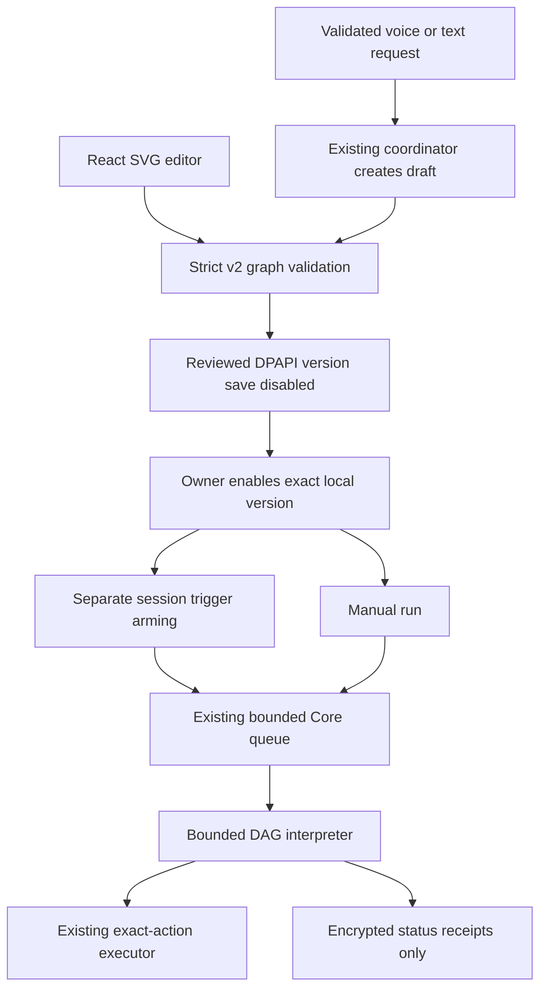

# Automation engine

`OperatingWorkspace` is owned by CoreApplication. It composes the workflow repository/interpreter, trigger scheduler, routine templates, feeds, selected tools and plugin/integration clients. It uses the existing serial queue, VoiceEngine, coordinator, permissions and shutdown ownership. Cloud is optional. Nothing executes merely because a workflow was saved, imported, synchronized, installed or scheduled.

Input, note, tool, condition, delay, approval, loop and output nodes are implemented. Edges define dependencies and condition ports. Joins run after all incoming predecessors settle and at least one active incoming edge is selected; unreachable nodes are skipped. References must name input/iteration or an upstream node. A missing output on a selected branch fails rather than fabricating a value. There is no eval/exec expression language or implicit retry.

Limits: 64 nodes, 128 edges, 64 tool effects, explicit loop count 1–10, individual delay at most 60 seconds, total deadline at most 300 seconds, 64 KiB contract, 64 KiB loop result and 256 KiB retained runtime outputs. Only one workflow runs in an owned Core. The interpreter checks linked cancellation and privacy between nodes/iterations and during delays; child processes and HTTP requests use their existing cooperative lifecycle. Each action still needs its own review; a checkpoint/schedule does not approve future actions.

SQLite schema 5 adds owner/category records, retained workflow versions, sanitized execution records and trigger receipts. All payloads use owner/role-bound Windows DPAPI. CAS revisions prevent overwritten edits; save/restore/import produces a disabled version. Fifty versions and 200 run records are retained; UI history returns the latest 100. Version inspection returns metadata, and restoration reviews the selected full definition. Runtime arguments/results are not execution history. A crashed `running` receipt becomes `interrupted`; it is never resumed automatically.

Seven editable routine templates use the same engine. Morning/work/focus/meeting/evening/night templates read explicitly configured feed observations, and custom starts with a note. Missing feeds report unconfigured. Voice/text `create workflow …` or `create routine …` uses the existing provider to draft then validates and reviews a disabled save. `run workflow <exact saved name>` / `run routine <exact saved name>` runs only an enabled matching local workflow with ordinary action approvals. Real model/acoustic drafting remains unverified.

Trigger categories are manual, voice, time, system, email, network and webhook. Daily IANA timezones skip nonexistent DST times and choose the first occurrence of repeated times. Interval schedules are bounded; missed policy is skip or once. Every schedule starts disabled, and all triggers start disarmed each session. Explicit arming is separate from configuration. Cooldowns, 16 pending source events, persistent hashed duplicate receipts and the existing bounded queue prevent unbounded work. Busy/crash events may be dropped, never replayed after an uncertain effect.

Time triggers are implemented; email/network/system source events can come from explicitly refreshed configured feeds. Trusted source interfaces accept voice/webhook events; there is no public webhook/Windows-control listener, automatic OS event subscription or external account event receiver. These event ingress integrations remain partial. Stop, lock, sleep, privacy or hiding the app disarms background work; hidden workflow action boundaries fail closed. DND/focus/gaming pause proactive feed polling and generic notifications. External polls still require exact review and outbound policy.

Workflow sync retains v1 inert compatibility and validates v2 data only. Credentials, authority fields and enablement do not synchronize. Incoming replicas require a separate reviewed import, new local identity and owner enablement. Connected tombstones disable imported copies; an offline device cannot learn remote revocation immediately. No cloud endpoint executes a desktop workflow.
