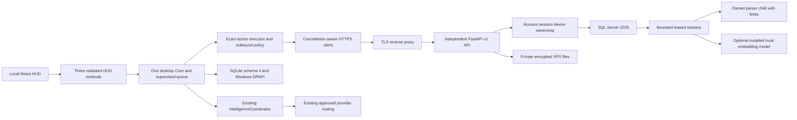

# CLYDEX Phase 05 cloud architecture

The owner approved this engineering baseline on 2026-11-28: self-hosted FastAPI, SQL Server 2025 on supported Ubuntu, private VPS filesystem storage, server-managed AES-256-GCM envelope encryption, separately stored keys and owner-held encrypted recovery exports. The VPS can decrypt for ingestion/search. **This is not end-to-end encryption.** Production edition/licensing, hosting, public exposure, private-data transfers and model installation remain separate owner decisions.

## Boundaries and ownership

`cloud/` installs as a separate Python package and imports only shared headless contracts/parsers from `clydex`. It never instantiates the desktop, voice runtime, AI coordinator or Windows tools. `src/clydex/cloud` is a standard-library desktop client, not a second server. The desktop starts without cloud credentials, network probes, paid calls or model downloads. Cloud configuration failure disables that feature while preserving local startup.

The existing exact-action executor owns every desktop transfer, queue application, cache mutation and configuration change. Reviews show destination, operation, relevant arguments and transmitted data; passwords are bound by a digest rather than displayed. Every outbound call rechecks cancellation, Windows lock, startup cloud ceiling, privacy personality and Offline routing. API responses, documents, wake words and models cannot grant capabilities. Stop prevents subsequent work; it cannot undo an already committed remote effect. Local DNS cancellation retains the existing OS-resolution limitation.

## Independent service

`api/app.py` defines versioned REST routes and Pydantic contracts. Authentication runs before protected body parsing. Generic health/readiness do not disclose accounts or credentials. Readiness checks migration SHA and SQL major version. Only explicit operator migration tools can create the schema. Public registration is off; optional invitation registration is one-use. OpenAPI/docs are authenticated and disabled by default, with a local generated contract in `cloud/openapi.json`.

Requests have Host/TLS checks, 16 concurrent request slots, two concurrent authentication slots, 8 authentication requests/minute/IP and a configurable 120 other requests/minute/IP default. Rate buckets are bounded at 4,096, per-process. Deployment uses **one API process**; adding replicas requires a reviewed shared rate limiter. JSON is bounded to 256 KiB; uploads to 10 MiB; headers to 16 KiB. Device claims also use the authentication limiter. No CORS wildcard, WebSocket, Windows control endpoint, uploaded-code executor, cloud AI engine or arbitrary remote URL fetch exists.

The request logger writes JSON request ID, HTTP method, route template, status and duration only. It omits URLs/query strings, filenames, tokens, IP addresses and bodies. SQL hides parameters; parser processes suppress library diagnostics; worker errors use fixed codes. Reverse-proxy access logs are disabled and Docker log rotation is templated. The API does not trust forwarded headers itself; the deployment pins the trusted proxy network and the proxy replaces forwarded values.

## Encryption and recovery

Passwords use Argon2id (64 MiB, three iterations, parallelism one). Opaque access tokens expire after five minutes by default. Refresh tokens rotate once with an absolute 30-day limit, are HMAC-hashed in SQL and revoke their session family on replay. Every authenticated request checks account/session/device revocation. Credentials stay in desktop RAM; Windows lock clears them. No stored key or reusable session token is exposed through the HUD.

Each account has a random 256-bit data key wrapped by a separate server master key. AES-GCM nonces are random, and associated data binds owner and purpose/object/version. Private account profiles, device names, document metadata, chunks, vectors and synchronization payloads are encrypted. Original files use generated UUID paths and authenticated ciphertext. Keyword indexes use owner-keyed HMAC terms: they disclose equality/frequency within an owner and are not a searchable-encryption proof. Ownership IDs, sizes, timestamps, status and relationships remain metadata. Disk encryption/TDE can complement this design; neither is falsely claimed installed.

`master.key` and `auth.key` are distinct 32-byte files outside SQL and file storage. Linux permissions are checked. Losing both keys and all recovery exports loses access; a compromised running server can read content. A full-service recovery export encloses key material, SQL rows and encrypted file objects under a passphrase-derived key. The owner must hold a strong recovery passphrase separately. Restore refuses populated targets and revokes recovered sessions/devices. A tested logical fixture restore is distinct from an untested native SQL Server `.bak` restore. See [deployment and recovery](CLOUD_DEPLOYMENT_GUIDE.md).

## Code responsibilities

| Location | Responsibility |
|---|---|
| `cloud/src/clydex_cloud/api`, `core` | REST contracts, middleware, protected configuration, envelopes, lifecycle and logs |
| `authentication`, `devices` | Provisioning, recovery, session rotation, pairing, fixed scopes and revocation |
| `repositories` | Parameterized transactions, shared schema, reviewed packaged migrations |
| `knowledge`, `storage`, `workers` | Encrypted originals, formats, citations, native-vector gate, parsing and leased jobs |
| `synchronization` | Category consent, versions, idempotency, mirrors, conflicts and tombstones |
| `src/clydex/cloud`, `synchronization`, `knowledge` | Desktop transport, DPAPI outbox/inbox/cache and shared-coordinator RAG |
| `frontend/src/features/{cloud,knowledge,devices,synchronization}` | Actual backend state and reviewed controls |

## Current limits

SQL tests use an explicitly injected SQLite simulation unless the separate guarded native suite is authorized. Native SQL DDL, locking/deadlock behavior, Linux deployment, driver CA setup, real embedding inference and production capacity remain unverified. No SQL image, large model or VPS was provisioned. Ubuntu/SQL/edition/vector reconciliation is in [DATABASE_DESIGN](DATABASE_DESIGN.md); format and prompt-injection boundaries are in [KNOWLEDGE_VAULT](KNOWLEDGE_VAULT.md).
