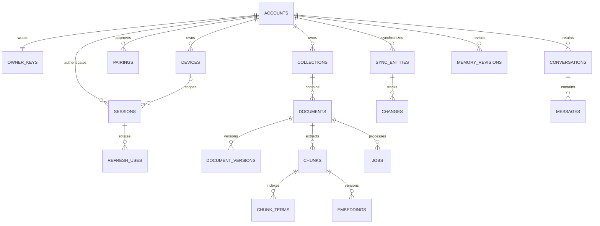

# SQL Server and local synchronization design

## Phase 06 local additive migration (2026-11-28)

Desktop schema 5 adds DPAPI owner/category operating records, retained workflow versions, encrypted sanitized run statuses and hashed trigger receipts with bounded retention/quotas. Migration remains transactional, preserves existing history/memory/cloud/settings/audit tables and refuses downgrade. Back up the prior profile before a real upgrade; rollback uses a separate prior-profile backup, never forced schema-number changes. Cloud remains SQL Server 2025 with the same production schema/encryption boundary; no alternative primary database, production migration or native SQL acceptance was introduced.

## Approved database baseline

Product decisions D33/D53–55 retain local SQLite, Microsoft SQL Server, Ubuntu and private VPS files. The owner explicitly approved SQL Server **2025 (17.x)** for this engineering implementation, with GA vector types/exact distance only. Microsoft lists Ubuntu 22.04/24.04 with XFS/ext4 among supported Linux configurations; SLES support was removed in this release. Production images, updates and host support must be checked again before deployment. [Microsoft Linux release information](https://learn.microsoft.com/en-us/sql/linux/sql-server-linux-release-notes-2025?view=sql-server-ver17).

Microsoft's Linux installation minimums include x64, two CPU cores at 2 GHz, 2 GB RAM to start SQL Server and 6 GB disk. Those are engine minimums, not sizing evidence for the API, parser workers, models or production workload. No workstation/VPS benchmark substitutes for deployment qualification. [Linux installation requirements](https://learn.microsoft.com/en-gb/sql/linux/sql-server-linux-setup?view=sql-server-ver17).

Developer editions are development/test licensing choices, not a production license. SQL Server 2025's Express edition information lists a 50 GB relational database limit; edition/platform features and actual license terms still need owner review. No production edition or purchase is selected. [Microsoft editions](https://cdn-dynmedia-1.microsoft.com/is/content/microsoftcorp/microsoft/bade/documents/products-and-services/en-us/owned-and-operated/SQL-Server-2025-Editions.pdf), [license terms](https://www.microsoft.com/content/dam/microsoft/usetm/documents/sql-server/sql-server-2025-developer%2C-express%2C-evaluation/retail/SQL_Server_2025_Developer_Express_and_Evaluation_Edition_English.pdf).

The production adapter rejects every database driver except `mssql+pyodbc`, requires ODBC Driver 18, `Encrypt=yes`/`strict` and `TrustServerCertificate=no`, rejects opaque `odbc_connect` bypasses and duplicate case-insensitive query options, and checks server major version 17. SQLite injection requires both an explicit test-only adapter and test runtime. It is never an alternative primary cloud database.

## Relationships

The diagram describes logical relationships; exact physical FKs/constraints are authoritative in `repositories/schema.py` and generated DDL. Owner IDs are in every owned query and composite child FK, preventing cross-account parent references. UUID primary keys, per-owner entity keys, unique version/ordinal/model indexes and quota/dimension constraints complement application ownership checks. No row-level-security or SQL encryption-at-rest installation is claimed.

## Version 1 cloud schema (26 tables)

| Tables (`clx_` prefix) | Stored state |
|---|---|
| `accounts`, `owner_keys` | Login HMAC, encrypted profile, password/recovery hashes, quotas, wrapped account key |
| `devices`, `pairings`, `sessions`, `refresh_uses`, `invitation_uses` | Encrypted device/pairing metadata, fixed scopes, expiry/rotation/revocation and one-use claims |
| `preferences` | Encrypted category preferences and sync consent |
| `conversations`, `messages`, `memory_revisions` | Explicit approved encrypted data and revisions |
| `collections`, `documents`, `document_versions` | Owner-isolated metadata, checksums, generated file IDs, current/revision/version and parser metadata |
| `chunks`, `chunk_terms`, `embeddings` | Encrypted excerpts/locations, blind keyword hashes, encrypted versioned vectors |
| `sync_entities`, `changes`, `sync_state`, `operations` | Entity versions, incremental cursor, delivered-device cursor, digest-bound idempotency and tombstones |
| `jobs`, `storage_garbage` | Bounded leased work and retryable post-commit file deletion |
| `audit`, `backups`, `schema_versions` | Allowlisted metadata, encrypted-export checksums/status and migration checksums |

Five explicit secondary indexes cover owner/cursor, documents/collection, job status/lease, chunk document/version and session owner/device. Unique constraints create additional supporting indexes. Constraint names include the full unique-column list; a packaged-DDL regression verifies schema-wide name uniqueness, preventing collisions that SQLite simulation would otherwise permit. SQL calls use bound parameters; the native vector dimension is the sole dynamic SQL type fragment, validated as an integer 1–1998.

## Migration and rollback

Canonical DDL lives in `cloud/src/clydex_cloud/repositories/migrations/001_core.sql` and `001_core.down.sql`; no second drifting copy is maintained. `python scripts/generate_cloud_schema.py` regenerates these from metadata. `python -m clydex_cloud.cli migrate` is an explicit operator command using one SERIALIZABLE transaction and a migration SHA-256. Existing mismatched/partial schemas fail closed. The API never migrates at startup. `rollback-empty` refuses any populated business table; populated rollback is a reviewed restore into a separate empty database.

Tests compile actual T-SQL, exercise simulated transactions and provide `test_native_mssql.py`, skipped by default. A native run requires separate approval, a protected URL file and an **empty disposable `clx_phase05_*` database**. That test checks native DDL, idempotent migration, transactional rollback, FKs/indexes and GA `VECTOR_DISTANCE`, then removes only its empty schema. No existing local SQL service has been used. SQL Server locking, actual migrations/rollback and native restore remain external gates until that run succeeds.

## Native vectors without preview features

SQL Server 2025 GA vector types/functions differ from preview approximate indexes/`VECTOR_SEARCH`. This implementation never enables `PREVIEW_FEATURES`, creates an ANN index or silently installs another vector database. [Microsoft vector availability](https://learn.microsoft.com/en-us/sql/sql-server/ai/vectors-faq?view=sql-server-ver17).

Vectors stay AES-GCM encrypted in SQL. A bounded owner/collection/model/version-filtered set is decrypted transiently and passed as bound parameters to SQL Server `VECTOR_DISTANCE('cosine', CAST(... AS VECTOR(n)), ...)` expressions. Up to 1,000 candidates are scanned, in 600-row batches below SQL Server's 2,100-parameter limit. Larger collections require a narrower filter; there is no hidden keyword substitution. This sacrifices ANN scale to preserve the approved encryption and GA-only baseline. Real model inference/native distance/performance are **unverified**. Re-indexing tracks exact installed model digest/dimension/license and does not download anything.

## Desktop SQLite schema 4

The additive local migration preserves schema 1–3 settings/audit/history/memory and adds `sync_state`, `sync_outbox`, `sync_inbox`, `sync_links`, `sync_replicas`, `knowledge_cache`. Private payloads remain Windows DPAPI ciphertext, additionally bound to owner/origin/account/role. Sync mappings and memory/history imports share one SQLite transaction. No DPAPI ciphertext is uploaded or expected to decrypt on another device. Downgrades are refused; restore a pre-upgrade local backup rather than opening schema 4 with older code.
