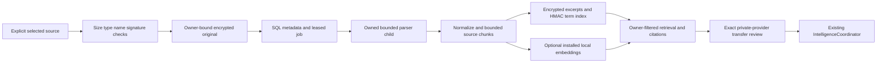

# Knowledge Vault

## Actual formats and provenance

All source content is untrusted data. There is no uploaded-code/macro/SQL executor, URL crawler or automatic local-folder watcher. Uploads require authenticated ownership and a collection. The desktop requires a native explicit file/folder selection and an exact reviewed transfer; selected files are fingerprinted and rechecked after approval. Folder imports are bounded snapshots: at most 16 files/20 MiB total, 10 MiB each, three nested levels, 500 inspected entries and a three-second inspection budget; hidden/reparse/symlink paths are excluded.

| Source | Implemented extraction | Capability boundary |
|---|---|---|
| UTF-8 text, Markdown, code, SQL, CSV/JSON/YAML/TOML | Literal normalized text, overlapping bounded chunks and character locations | Never interprets code, SQL, templates or document instructions |
| PDF | `pypdf` text layer; page + character/chunk references | Up to 300 pages; encrypted PDFs rejected; scans report `needs_ocr`; no invented OCR |
| DOCX | OOXML paragraph/table text; paragraph locations | No page-number claim, macros or Office automation |
| XLSX | OOXML cached/shared/inline cell values; sheet/cell locations | Formulas are not calculated; caches may be stale/absent |
| PPTX | OOXML slide text; slide locations | No rendering/image OCR or embedded-code execution |
| Saved web content | Uploaded HTML visible text, scripts/styles/templates removed | No remote URL fetch, JavaScript or external-resource loading |
| Personal notes | Explicit note title and Markdown/text upload | Same limits/provenance/ownership as documents |
| PNG/JPEG | Signature/container checks and encrypted storage | `needs_ocr`; no OCR model configured; JPEG checks are not full decoder validation |
| PCM WAV | Bounded local container metadata and encrypted storage | `needs_transcription`; no cloud STT, audio model download or transcription claim |
| Local folders | Explicit bounded file snapshot through native picker | No unrestricted scanning, background upload or continuous sync |
| DOC/XLS/PPT, general archives, other audio/image formats, live web URLs | Rejected/unsupported | Owner may explicitly convert with an appropriate trusted tool; never silently executes conversion software |

`pypdf` is BSD-3-Clause; `defusedxml` uses the PSF license; ZIP/XML/HTML/WAV handling uses the Python standard library. FastAPI/SQLAlchemy/argon2-cffi use MIT, Uvicorn BSD-3-Clause, cryptography Apache-2.0/BSD-3-Clause, and pyodbc MIT-0 package notices. Installed package metadata/notices and distribution terms still need release review; SQL/ODBC licenses are separate. [pypdf extraction limits](https://github.com/py-pdf/pypdf/blob/main/docs/user/extract-text.md), [defusedxml](https://github.com/tiran/defusedxml), [pypdf license](https://github.com/py-pdf/pypdf/blob/main/LICENSE).

## Pipeline and quotas

The default original-document quota is 100 MiB/account. Generated UUID file IDs live outside source/public web roots. Per-version SHA-256, encrypted file authentication, unique operation IDs and current-version duplicate detection protect transfer retries. Archives are never expanded to disk; OOXML ZIPs have entry, expansion, member-size, compression-ratio, traversal, symlink and macro checks. XML DTD/entities/external references are forbidden. Original-file quotas do not measure total SQL/VPS storage.

The queue caps active jobs at 32/account. One to four owned worker threads claim SQL leases, with three attempts. Processing rechecks lease, document version/deletion and shutdown before publishing. An interrupted/deleted/superseded job cannot publish later chunks. Parser subprocesses have a 20-second wall deadline, bounded JSON pipe, forced owned cleanup and Linux CPU/address-space/FD limits. These are defense-in-depth limits, **not an OS sandbox or antivirus claim**. Windows parser simulation verifies timeout/lifecycle behavior but not Linux resource isolation. Extraction caps include 1,000,000 text characters, 2,000 chunks/document and 10,000 indexed chunks/account.

Reprocessing creates a new bounded job for the selected version and clears its obsolete index; replacing content creates a new document version. Original versions remain available through authenticated API downloads until deletion. Deletion removes chunks/embeddings/version rows transactionally, publishes a tombstone and uses retryable garbage metadata for physical encrypted-file cleanup. A failed file deletion remains inaccessible and continues counting against quota until cleanup succeeds. Historical sync payloads are scrubbed on deletion. Recovery exports made earlier are separate retained copies; the owner controls their expiration.

## Retrieval and source-grounded questions

Keyword retrieval uses Unicode-aware terms, preserving Sinhala/Tamil combining marks; it is not a language-accuracy benchmark. Results include stable `K-...` citation ID, document/version/revision, source filename, location and bounded excerpt. Owner/collection filters apply before ranking. Literal synthetic fixture tests verify expected source IDs, location and text, including cross-account rejection.

Optional semantic retrieval uses an explicitly installed licensed **local** Ollama embedding model. The service checks `/api/tags` for its exact configured digest, uses `/api/embed` with truncation disabled, validates finite nonzero vectors/dimensions, and never pulls a model or calls a paid/remote embedding provider. The fixed service is literal loopback; container deployments need a reviewed local-sidecar/host-network arrangement before enabling it. No embedding model is installed or semantically benchmarked in this checkpoint. [Ollama API](https://github.com/ollama/ollama/blob/main/docs/api.md).

Native exact-distance limits and encrypted-vector tradeoffs are in [DATABASE_DESIGN](DATABASE_DESIGN.md). Unconfigured semantic mode returns an explicit error. Empty keyword evidence produces an insufficient-evidence answer without calling an AI provider. Nonempty questions reuse the existing coordinator, memory policy and provider routing; at most five excerpts/10,000 characters enter its private `retrieved_knowledge` compartment. Documents cannot change instructions, scopes or consent. External providers require their existing exact private-context approval. Citation IDs must be a subset of retrieved IDs and an asserted answer needs a citation. This checks **reference membership, not factual entailment**; live answer quality remains unverified.

## Offline use

Only explicitly selected extracted excerpts are cached, encrypted with Windows DPAPI and bound to account/endpoint/document. Cache defaults to 24 hours; configurable 1–720-hour expiration, 1–50 MiB aggregate encrypted-byte quota, 4 MiB per document. Offline keyword search makes no network call; an offline AI question requires an already configured local AI provider. No silent cloud fallback is possible for local-only context.

Connected change fetch invalidates older cached revisions/deletions; historical replay does not erase a newer cache revision. Authentication/revocation rejection clears that account's cache. A disconnected device cannot immediately learn remote revocation. Windows lock hides private results and clears RAM credentials; account-bound encrypted excerpts can remain available after a later unlock/restart until expiration or connected revocation. Review this retention tradeoff before selecting offline availability.

The functional React screens show observed collections/documents/jobs, versions, notes, source citations, quotas, offline status and stable errors. An explicit refresh observes processing changes; there is no fabricated live progress or auto-upload. Authenticated original-file download is currently an API capability; desktop export destinations are not exposed as arbitrary bridge paths.
