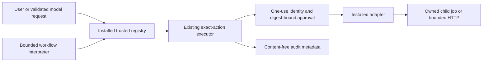

# Supervised operating tools

Phase 06 extends the installed `ToolSpec` inventory and the existing `ToolExecutor`; it does not add another operating agent or permission service. Names, scopes, risk, JSON contracts, platforms, time budgets, cancellation, destinations, idempotency and audit metadata come from application code. Models, workflow imports, plugin manifests and MCP annotations cannot supply authority. Unknown IDs, unsupported schemas and unexpected fields fail closed.

New tools require review, including read-only local diagnostics. Legacy LOW user operations and explicit context-free Codex requests retain their existing documented exceptions. Scope restrictions are checked again after review. Stop/cancellation is checked before and after execution; completed external effects remain. Native adapters own deadlines and process/socket cleanup. All desktop work enters the same Core queue.

| Capability | Actual implementation | Boundary |
|---|---|---|
| Applications/windows/browser/Outlook | Existing launch, accessibility, selected browser text, inbox and unsent drafts preserved | Earlier live acceptance remains pending; no new automatic sends |
| Selected files/folders | Nonrecursive bounded listing, metadata/UTF-8 read, checksum-checked write, mkdir, file/empty-directory delete | Native expiring selection IDs; no arbitrary bridge paths, scanning or recursive delete; same-user filesystem races are not an OS sandbox |
| Developer/system/database | Installed Git, fixed diagnostics, reviewed scripts, ODBC query classes, Docker and SSH adapters | Explicit selections/profiles and separate modifying scopes; see Developer Command Center |
| Knowledge/memory/intelligence | Existing Knowledge Vault, cache, consented memory and coordinator preserved | No second data store or AI engine; private context still needs outbound review |
| Screen/camera | Per-session opt-in plus per-snapshot review, visible native title indicator, explicit primary-screen/camera index, bounded worker and RAM-only expiration | Camera library/device and capture quality unverified; no hidden recording, OCR, image reasoning or external transfer claim |
| Media/smart devices | Reviewed Windows media keys, selected Home Assistant entity and MQTT exact topic | No device discovery or unrestricted remote control; live acceptance pending |
| Monitoring | Actual Windows system/process counters, runtime volume disk usage, optional `nvidia-smi`, configured diagnostic/HTTP sources | Scope and unavailable values are explicit; no unrelated network scan |

`tools/catalog.py` exposes installed metadata; `security/schema.py` validates a deliberately bounded schema subset. Legacy contracts retain their top-level Python validation and adapter-specific checks; their published result schemas describe supported types rather than claiming deep validation retrofits. New contracts have nested validation. Full JSON Schema composition/references and remote schema fetching are unsupported.

The three-method HUD accepts only `operating.action` with a fixed inner inventory and `operating.select` for native picker kinds. Sensitive review targets bind selected paths/checksums, script source and current profile/configuration revision. Changing a target during review fails. Reusable credentials are never returned; configuration reviews bind credential digests only. Audit stores digest, fixed tool name and outcome, never content or secrets.
