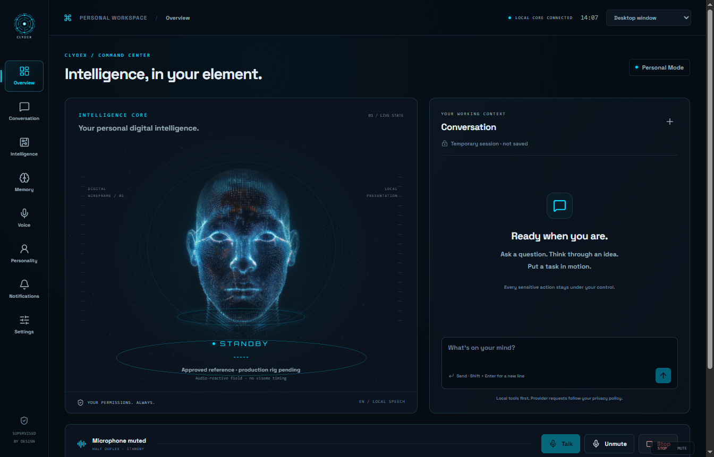
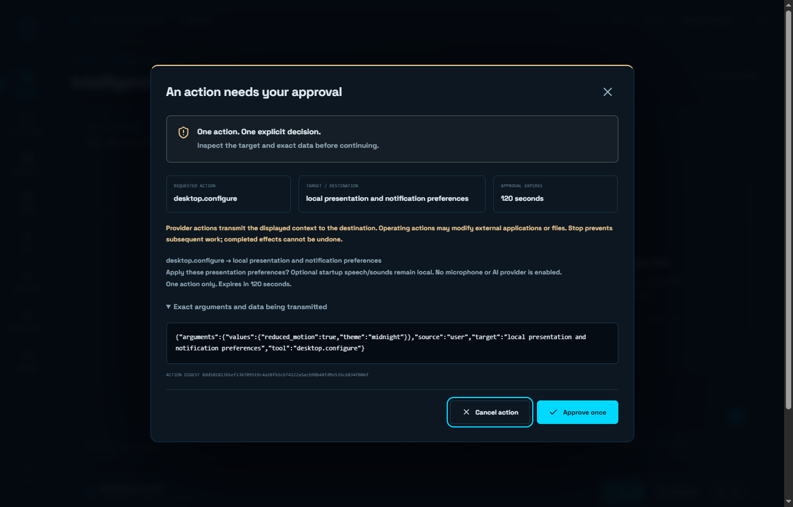

# Phase 04 — Cinematic HUD owner review checkpoint

Date: 2026-11-27. Branch: `v2`. Reviewed starting checkpoint: `5258c8f1513363c000a3b6fcdabdf4a6c2d18b90`.

Publication update: after this local handoff, the owner explicitly authorized committing and pushing the Phase 04 checkpoint to GitHub on `v2`. Engineering commit is `2b04092`; this report and its screenshots follow in the documentation commit. Local/uncommitted/no-publication statements in the original checkpoint narrative and verification JSON below are historical. New GitHub Actions results are not inferred from local checks. No main merge, tag, release, paid activation or Phase 05 work is included.

**Engineering is delivered using the explicitly authorized reference-avatar fallback. Production character assets and live acceptance remain pending.** Changes are local and uncommitted for owner review; no push, merge, tag, release, paid request, cloud activation or Phase 05 implementation occurred. `main`, `v1-old`, both official specifications, existing legacy artwork/UI and the supplied reference PNG bytes are preserved.

## Admission and completed tasks

Read AGENTS, both official specifications, Phase 02/03 completion/provider/voice records and management/architecture documents; inspected actual Core/Studio/coordinator/voice/data/personality/permissions/task ownership. Admission passed **185 V2 tests in 16.772 s**. Reviewed successful [Phase 03 CI run 45954460043](https://github.com/creolive-digital/CLYDEX/actions/runs/45954460043) at the exact checkpoint, including Python 3.11 checks, both EXEs, Inno and artifact upload; release skipped. No current Phase 04 CI result is claimed because this phase was not pushed.

| Task | Delivered engineering / boundary |
|---|---|
| P4-01 | Repository/specification/CI/regression admission; owner reference inventory/hashes and licensed asset evaluation. |
| P4-02 | React/TypeScript/Vite with local bundled assets, reusable controls/tokens, shared validated three-method Python bridge; working legacy fallback. |
| P4-03 | Functional command center and management screens using existing Core services, exact approvals, Stop/mute, history/memory consent, provider/routing, voice/personality and privacy controls. |
| P4-04 | Approved-face reference presentation with actual state/audio-reactive WebGL surroundings, renderer contract, measured playback metadata, disposal/fallback and resource controls. Rig-dependent facial/full-body work remains gated, not complete. |
| P4-05 | Six views of one native window/Core, safe monitor/geometry preferences, tray indicator policy and native approval restoration. |
| P4-06 | Actual ready/gated/unverified startup states, skip/silent/reduced motion, optional neutral local greeting and original procedural sound categories. Audible/shutdown behavior remains subject to browser/owner acceptance. |
| P4-07 | Bounded generic notification center/native tray notification adapter and one owned adapter reusing existing Tk time tools across views. |
| P4-08 | Declared Python/frontend/native/build/visual/performance verification below. Live acoustic/provider/production certification is separate. |
| P4-09 | Design system, avatar, frontend architecture, setup/installer and all management documents updated; actual screenshots and changed-file inventory retained. |

Requirement mapping includes UI-01, FEED-01, LIFE-01, VO-04, FND-01/05, AI/MEM integration and SEC-01–03; see REQUIREMENTS_TRACEABILITY and ADR-040–047.

## Implemented screens and native modes

Overview combines the exact Intelligence Core logo/approved face, real voice state, working chat, microphone controls, observed provider route, temporary-session/memory status and sampled OS counters. Conversation/history exposes search/new/save/rename/archive/resume/delete/retention/export; all effectful data changes retain existing ownership/reviews. Intelligence exposes all seven configured adapters, manual/automatic routing and Fast/Balanced/Advanced/Offline profiles without returning keys or probing accounts at startup. Memory exposes records, corrections/deletion, reviewed suggestions and collection consent. Voice exposes actual installed devices/voice metadata, independent recognition/synthesis languages, local models/download review, speed/volume and five activation settings. Personality exposes the existing nine profiles and optional encrypted addressing. Settings exposes themes/accent, motion/resource controls, startup/sounds/notifications, monitor selection and constrained permission scopes. Notifications contains genuine generic local events, with an actual empty state.

| Display mode | Implemented behavior / actual verification |
|---|---|
| Standard window | Resizable native WebView2; restored bounded standard-window geometry/monitor. Native client screenshot at initial 1360×900 outer window. |
| Full-screen command center | Same native window; Escape returns to standard. Native transition exercised. |
| Desktop Smart Widget | Existing clock/timer/alarm/stopwatch/weather logic through one lazy Tk owner. Running timer survives view switches; Stop/mic controls remain fixed and visible while tools scroll. |
| Floating Hologram | On-top compact approved reference with voice/Stop controls and open-center action. Framed native window; no unverified transparent compositor claim. |
| Mini Voice Bar | Compact status/spectrum/Talk/Unmute/Stop view of the same Core. |
| System Tray | Reviewed native tray required before hiding. Native menu retains open/talk/mute/Stop/exit. A new approval restores the full window; no hidden capture is enabled by switching modes. |

Native moves between **both detected monitors** succeeded. Logical negative coordinates and saved-bound restoration also have deterministic tests. Mixed DPI, taskbar/work-area edge cases, docking, long-idle and a broader hardware matrix remain external acceptance. Standard window is restored at launch rather than silently reopening a hidden/on-top mode. Standalone legacy widget remains an independent fallback, not a synchronized second widget instance.

## Visual identity, avatar and audio

The supplied logo and masculine cyan face are used byte-for-byte; no replacement branding/face was generated. Orbitron, Space Grotesk, monospace, Cyber Cyan/dark panels, Lucide icons and reusable tokens follow the product direction. Local font/icon/framework license notices ship in the bundle. SHA-256/provenance and official MakeHuman/MetaHuman asset evaluations are documented in AVATAR_RENDERING; no optional character asset was downloaded. The owner still needs to establish production artwork redistribution provenance and supply/approve a matching optimized rig.

Three.js draws disposable particles and a surrounding floor ring, while CSS adds scan/materialization/drift/glow/sleep presentation. The exact reference stays visible if WebGL is unavailable or loses context. Real standby/wake/listen/transcribe/think/approval/speak/interrupted/sleep/error states drive presentation. Actual amplitude/frequency/waveform drive energy effects; observed sample rate/final playback frames/completion pass through the renderer interface and caption. No audio was fabricated for screenshots. Synthetic metadata tests verify counter propagation independently.

The reference is **not** a production 3D character. Eyes do not blink; the face/head/jaw is not articulated; emotion/full-body/gaze and precise phoneme/viseme lip synchronization are not implemented. The separate audio envelope is an energy indicator. These limitations are explicit in the UI and asset documentation. Phase 03 wake model, cinematic neural voice, Sinhala/Tamil/Singlish acoustic quality, echo cancellation and live voice/provider acceptance gates remain open.

## Privacy and security verification

The new WebView exposes only `hud_snapshot`, `hud_read` and `hud_command`. Python validates the shared operation inventory, exact primitive/field schemas, finite canonical JSON and 64 KiB bound; typed existing services validate nested configuration. No arbitrary execution/filesystem/shell/credential-get method was added. CSP and local assets avoid remote script/font dependencies; model/tool text is rendered literally. Existing keys never return to the UI.

Provider/data/voice/personality/settings/capability actions reuse Studio, one supervised queue, trusted ToolSpecs and the central executor. Exact reviews display action, target/destination, arguments/data, expiry, digest, consequences and approve-once/cancel. Native modal initial focus is Cancel. Compact/hide during review is refused; native restoration works from tray without browser timer dependence. Startup-disabled scopes cannot be relaxed from presentation settings. Personality/theme cannot grant permissions, activate memory or enable capture/providers.

Native lock watcher and action-time voice guards remain authoritative; a synthetic lock probe verifies complete private-form/chat/review removal and Stop/mute availability without locking the owner's PC. Memory add/delete and absence of the synthetic plaintext from SQLite were verified with the actual encrypted repository. Preferences contain non-secret presentation/geometry/scopes outside source; no raw audio/private transcript/log content was added. No physical lock/disconnect, spoken authentication, paid request, actual microphone/speaker/model inference or private production data was tested. Completed external effects remain irreversible.

## Actual verification and performance

Workstation: Windows 10, Python 3.13.14, Node 24.13.1/npm 11.8.0; Intel Core i7-7500U (2 cores/4 logical processors), Intel HD Graphics 620 and NVIDIA GeForce 930MX enumerated. Active rendering GPU was not established. Default `py` installation was not changed.

| Check | Actual result / scope |
|---|---|
| Complete V2 suite | **201 passed in 26.385 s**, including original four V2 voice regressions and 16 HUD contract/privacy/display/playback tests. |
| Separate archive process | **4 passed in 0.004 s** from `v1-old`; source unchanged. |
| Frontend unit/component/lifecycle | **16 passed**, four Vitest/jsdom files, 16.84 s in the final frontend check; contract/privacy, literal chat, exact review/Cancel focus, memory consent, Stop/mute, polling teardown, startup timing, rendering/fallback and muted sound history. These are simulated DOM tests. |
| TypeScript and Vite production build | Passed; final recorded Vite build 2.46 s. Three.js is lazy-loaded. Advisory chunk-size warning remains for the approximately 533 kB uncompressed renderer; it is packaged locally and not a runtime CDN dependency. |
| Lint/compilation/legacy JS | Ruff passed; Python compileall and retained JavaScript syntax checks passed. |
| Native HUD | Production build in actual PyWebView/Windows WebView2; three exposed API methods, seven-provider rendering, loaded voice settings, memory encrypted CRUD/UI refresh, exact review, six modes, active shared timer, two monitors, lock-probe shield, reduced/minimized suspension, context-loss fallback and joined Core/Tk/tray shutdown passed. No audio/network request. |
| Actual `.pyw` entry point | Executed the launcher main path through a controlled isolated Studio factory with `--silent --reduced-motion`; native HUD/three-method bridge/Stop, muted/disabled defaults and joined shutdown passed. This is a safe launcher smoke, not a production profile test. |
| Legacy native smoke | Real Tk startup, clock, compact/full, timer/alarm/stopwatch, legacy WebView2, seven providers, encrypted synthetic history, nine personality profiles, reviewed voice settings and synthetic lock shield passed; weather mocked. |
| Packaging | Widget and agent clean PyInstaller builds succeeded in fresh work directories. All 14 packaged frontend files are byte-identical to the final Vite build; shared contract, embedded native dispatch/geometry restore, widget module and Tk resources verified. The actual frozen agent opened a native window and exited cleanly with a disposable profile and silent/reduced flags; this is not frozen DOM/audio/provider certification. [Package evidence](evidence/phase04/package-results.json). Wheel includes the HUD JSON contract. Local Inno compiler is absent; installer definitions/paths and CI are updated, but no new local Inno/fresh install or remote CI success is asserted. |

The final native sample rendered **27 frames over 2 seconds** in standby (approximately 13.5 FPS under the 15 FPS idle cap), **0 frames over 1 second minimized**, and **0 continuous frames over 1 second in reduced motion** after the final static redraw. Native client viewport was 1344×861 at DPR 1. The sampled Python process working set was **105,263,104 bytes** before opening the widget; this excludes WebView2 subprocesses and GPU allocations. System memory load was 65%; system-wide CPU was 90.4%, not app CPU. These short samples on a busy workstation establish measured behavior, not target hardware certification, sustained FPS, speech latency or a complete application resource benchmark. Raw values are in [native-results.json](evidence/phase04/native-results.json).

Development findings fixed: Windows `.js` MIME registry misclassification; startup timer reset by cloned poll preferences; native modal focus overriding React autofocus; and PyWebView's direct worker-thread TopMost setter causing an intermittent native hang. The latter was diagnosed with a thread trace, marshaled through WinForms Invoke and verified with a deterministic affinity test plus repeated native active-timer mode runs. Smart Widget emergency controls were pinned after visual inspection. One unrelated full-suite run under concurrent workloads hit a Windows temporary-directory sharing failure after descendant-process assertions; six isolated hardening tests and subsequent full suites passed without weakening tests. One concurrent legacy smoke assertion failed; its serial rerun passed. Findings and limits are retained in OPEN_ISSUES rather than hidden as successful acceptance.

## Actual screenshots

Client-area captures use WebView2 CapturePreview of this disposable application only; they do not photograph the owner's desktop. Native outer sizes differ from image client dimensions due to Windows borders/title bars. No inference, private session, audio quality or accurate lip-sync result is depicted.

Additional actual views: [760 px window](evidence/phase04/overview-760.png), [Intelligence](evidence/phase04/intelligence.png), [Memory](evidence/phase04/memory.png), [loaded Voice settings](evidence/phase04/voice.png), [Settings](evidence/phase04/settings.png), [Smart Widget](evidence/phase04/smart-widget.png), [Floating Hologram](evidence/phase04/floating.png), [Mini Voice Bar](evidence/phase04/mini.png), [synthetic lock shield](evidence/phase04/locked-synthetic-probe.png), [WebGL fallback](evidence/phase04/webgl-fallback.png) and [startup](evidence/phase04/startup.png).

## Files, migration and remaining owner decisions

The complete created/modified path inventory is [CHANGED_FILES.txt](evidence/phase04/CHANGED_FILES.txt). It includes the two owner-supplied reference files as preserved intake assets, not invented artwork. Major additions are the frontend package/source/tests, font/OFL, desktop HUD/contract/display/preferences/system/notifications/widget adapter and tests, safe native verifier and these design/architecture/evidence records. Launcher, ToolSpecs/tray, package data, installer/build/CI and all management/setup instructions are updated. No archive/official specification changes or generated build output are tracked.

Runtime presentation/geometry/monitor/capability preferences are atomic non-secret files under `%LOCALAPPDATA%/CLYDEX/settings`; schema 3 conversations/memory remain unchanged. Build output stays ignored under deployment artifacts. Setuptools wheel intermediates were preserved outside the repository root. Rollback is `--legacy` (or `CLYDEX_FRONTEND=legacy`) after closing this Core, retaining encrypted data and voice policy; the existing standalone widget remains available. A missing source HUD build automatically selects legacy. No schema downgrade/deletion is required.

Owner decisions/gates: approve the developed visual experience and reference use; provide identity-matching rig/animations and production rights; select/audition licensed cinematic TTS and validated Hey CLYDEX assets; approve real acoustic/model/language/provider tests; qualify physical lock/disconnect, mixed DPI, accessibility/keyboard/screen-reader, long-idle, audio/sounds and sustained CPU/GPU/RAM; run current CI/Inno/fresh installation when publication is explicitly authorized. No automatic paid activation or large download follows this checkpoint.

Phase 05 has a maintained frontend boundary and existing shared services to build on, but cloud/VPS/SQL Server/Knowledge Vault/plugins/mobile/robot implementation is **not authorized or started**. Stop here for Phase 04 owner review.
