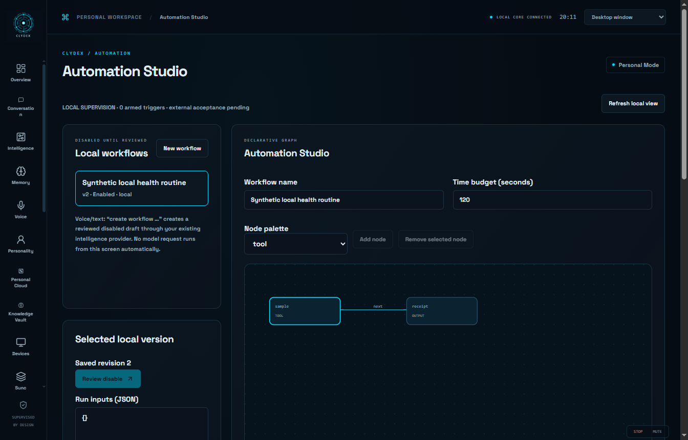
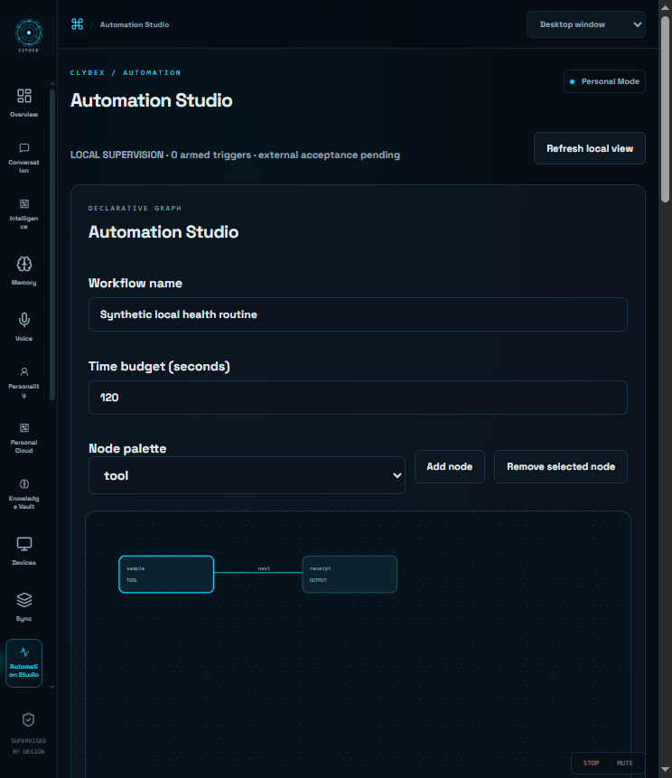

# Phase 06 — Operating Intelligence, Automation and Plugin Ecosystem

Publication update: after the local engineering handoff, the owner explicitly requested a GitHub push. The reviewed checkpoint is authorized for commit/publication on `v2` only. The uncommitted/unpublished/no-push statements and verification flags below describe the original handoff. No deployment, main change, merge, tag, release, workflow recreation or later-phase work follows from publication. Pre-publication review matched all 109 changed paths to the checkpoint manifest, verified protected paths/main/archive unchanged and found no newly introduced high-signal credential literals; the matching secret-pattern fixture was already present in the reviewed baseline. Engineering test/build/native evidence and remaining acceptance gates are unchanged.

Date: 2026-11-28. Branch: `v2`, reviewed base `f39fb8080af5f91972602a5b7b7a8fedd2fb76ee`. This is a **bounded local engineering owner-review checkpoint**, not a production-ready product or live-integration certification. Changes are uncommitted/unpublished. No push, merge, tag, release, cloud deployment or GitHub Actions workflow was created.

The local implementation is functional within the inventories below. Dynamic SDK extensions, external event ingress and several optional/native integrations remain explicitly partial or unverified. Owner review must include these limitations; the report does not label every requested category fully complete.

## Admission and preservation

Inspected AGENTS, both official specifications, Phase 02–05 reports, management/architecture/testing/provider/voice/UI/cloud/database/knowledge/synchronization records and the actual Core, coordinator, registry, queue, trusted tools, approvals, HUD, React, persistence and cloud contracts. The tree was clean at the reviewed Phase 05 checkpoint. Admission passed **222 desktop tests (28.451 s)**, **28 cloud tests plus one native SQL skip (47.086 s)**, **22 frontend tests (21.81 s)**, TypeScript and production build (Vite 2.46 s). Phase 05 native/package evidence was reviewed. No admission regression or production resource was used.

Main, `v1-old`, official specifications, approved logo/face and legacy assets are preserved. Runtime, private fixtures, plugin copies, temporary profiles and build products remain outside source. The owner's removed automatic workflow stays absent. Earlier SQL Server/VPS/embedding, acoustic/wake/language and production-avatar gates remain pending.

## Task disposition

| ID | Implemented engineering | Boundary |
|---|---|---|
| P6-01 | Repository/specification/admission review and external gate separation | Earlier pending live/native acceptance remains open |
| P6-02 | Extended trusted ToolSpecs, bounded schemas, installed registry, post-review scope/cancellation checks and metadata | Legacy adapters retain documented approval exceptions/deep-validation limits |
| P6-03 | Selected files/folders, preserved app/browser/mail capabilities, reviewed media and bounded visible capture interface | No scanning, hidden recording, OCR/image reasoning or camera acceptance claim |
| P6-04 | Git/status/diff/branches, selected scripts, fixed Windows/IIS/SSH/Docker diagnostics, explicit SQL classes, Docker/service changes and coordinator assistance | External/native dependencies/accounts/profiles and live writes remain unverified; unsupported operations are not exposed |
| P6-05 | Versioned DPAPI workflows, bounded DAG/conditions/loops/delays/checkpoints/outputs, dry-run previews, receipts, restore and React SVG editor | Real voice/model drafting quality and human UX qualification pending |
| P6-06 | Disabled/session-armed timezone schedules, duplicate/cooldown/missed policies and seven editable routines | Trusted source interfaces for voice/webhooks; full external ingress/subscriptions remain partial |
| P6-07 | Configured observed feeds, stale/failure/provenance, opt-in polling and shared system/process/disk/optional GPU adapters | No default polling/paid calls or fabricated server/network health |
| P6-08 | Disabled local plugin install, manifest/path/version validation, source trust/hash pinning, owned runtime, SDK contracts and synthetic example | Dynamic feed/event/integration/health extensions are typed contracts; hostile-plugin containment is not delivered |
| P6-09 | Explicit modern MCP JSON/SSE discovery/schema review/calls and official integration codecs | Legacy/stdio/MRTR/OAuth onboarding and live external service acceptance remain unsupported/unverified |
| P6-10 | Backward-compatible inert v1/v2 workflow synchronization, disabled reviewed local copies and connected deletion safety | Offline revocation is delayed; handles/grants/credentials do not synchronize |
| P6-11 | Nine functional HUD management views, existing three-method bridge, native selections, review/Stop/mute and activity metadata | JSON contracts are an advanced editor; full human accessibility review remains pending |
| P6-12 | Expanded deterministic/loopback tests, actual Windows/UI/DPAPI checks and local build/package verification | See exact evidence below; mocks are not live acceptance |
| P6-13 | Eight requested documents, diagrams, examples, screenshots and maintained tracking records | No later-phase work or release authorization |

## Architecture and actual operating capabilities

CoreApplication owns one OperatingWorkspace, the existing serial queue/VoiceEngine, IntelligenceCoordinator, providers, memory/conversations, voice and cloud services. The installed registry routes through the existing exact-action executor. No second operating agent, AI/voice/memory/authorization service or public Windows-control endpoint was added. The scheduler submits into the same queue; Stop and shutdown retain ownership until actual work/resources finish.

New adapters cover explicit selected-path listing/read/metadata/checksum write/mkdir/file-or-empty-directory delete; Git status/history/actual bounded diff/branches/clean create-switch; selected reviewed Python/PowerShell; fixed Windows services/network/process/IIS; explicitly configured SSH diagnostics and literal service restart; Docker selected-context inventory/version and exact-container start/stop/restart; separate ODBC read/write/schema profiles; official service requests; media keys and individually reviewed capture. Existing app/window/accessibility/browser/Outlook/knowledge/memory capabilities are reused. Git push/reset/merge/release, Docker arbitrary run/exec/delete, hidden capture and unrestricted filesystem/network operations are not new tools.

SQL uses ODBC 18 verified TLS, owner-provisioned Credential Manager passwords, transactions, query/lock/child deadlines and bounded results. Read classification is conservative; server least privilege is mandatory and no parser is an SQL sandbox. **No real SQL Server connection/query was executed.** Camera/OpenCV, MQTT/Paho and optional ODBC runtime deployment require selection/qualification. The private source/frozen helper handles a fixed operation inventory with bounded pipes/jobs and does not construct another Core. Executable scripts/plugins run with the Windows user's authority after trust/review; process limits are not an OS sandbox.

## Automation, scheduling and feeds

Contract v2 validates IDs, explicit input schemas, typed node configuration, dependency references, branch ports and acyclic graphs. Limits are 64 nodes, 128 edges, 64 effects, loop count 1–10, delays ≤60 s, deadline ≤300 s, contract ≤64 KiB and retained outputs ≤256 KiB. No eval/exec expression language, implicit permission grant or automatic action retry exists. Output mapping resolves actual predecessor data. Failure/cancellation stops later actions; previously completed effects remain.

Schema 5 adds owner/role-bound DPAPI operating records, CAS versions, encrypted status-only run receipts and hashed trigger duplicates. Save/restore/import disables the new version; crash receipts become interrupted without automatic replay. The editor adds/removes/moves/connects nodes, edits parameters/input schema, previews through Python, saves versions, enables/disables, runs saved versions and shows sanitized progress/history. Voice/text drafting uses the existing coordinator and validates/reviews a disabled draft; live model/acoustic creation remains unverified. Selected reviewed scripting is a controlled tool node, not inline workflow code.

Manual run, explicit exact-name voice/text run and time scheduling are implemented. Schedules start disabled and each session starts disarmed. Daily IANA timezones handle DST gaps/repeated times; interval, cooldown, bounded queue, duplicate receipts and skip/once policies are implemented. Feed-derived system/email/network events and trusted voice/webhook event interfaces exist. **No automatic Windows/email subscription or HTTP webhook receiver is delivered.** Busy/crash events may be dropped rather than replayed. Stop, lock, sleep, privacy and hidden presentation disarm background work. Subsequent hidden workflow actions are blocked.

Morning/work/focus/meeting/evening/night/custom routines are ordinary editable workflows. They read actual configured feed observations, including stale/unconfigured status; no weather/news/calendar data is invented. All eleven feed categories have explicit source/configuration/status contracts. External feed polling is read-only, separately armed, privacy-reviewed, timestamped, and paused by DND/focus/gaming. Local system/tasks observations work without cloud. Monitoring labels system-wide CPU separately from Python process CPU/memory, reports actual runtime-volume disk use and optional NVIDIA counters or unavailability; server/network sources are explicitly configured, never scanned.

## Plugins, MCP and integrations

Local source packages are bounded, checksummed, installed disabled and never downloaded or automatically executed. Enabling requires explicit OS-user code trust; every invocation still uses HIGH-risk exact review. Changed source fails closed. Update metadata is installed version/hash/health, with separate reviewed reinstall; there is no invented marketplace/update service. SDK tool/context/cancellation/log/configuration protocols, workflow wrappers and example are delivered. Feed/event/integration/health interfaces are **contracts**, not automatically loaded runtime extensions. The initial child receives an empty configuration object. Hostile third-party code must remain disabled pending a separately reviewed containment design.

MCP is pinned to official **2026-07-28 Streamable HTTP**, with per-request version/client metadata, identity/capability discovery, bounded JSON/SSE, supported schema/header validation, fingerprint review, per-server enablement, timeouts/cancellation and safe errors. Discovery grants no authority. Legacy/stdio, complex JSON Schema, roots/sampling/subscriptions/MRTR authorization and arbitrary server launch are unsupported. Tool descriptions/results remain untrusted. See [MCP configuration](MCP_CONFIGURATION.md).

| Integration | Actual support | Live status |
|---|---|---|
| Microsoft / Google | Read-only Graph mail/calendar metadata; Gmail IDs and selected Calendar events | Codecs/fixtures only; OAuth/accounts/scopes pending |
| GitHub / Azure | Selected repository/issues/reviewed issue creation; Reader resource-group inventory | Synthetic fixtures; no real issue/resource action |
| Telegram / Discord / WhatsApp | Official selected bot/channel/phone text request codecs | Synthetic only; legitimate account/token/subscription/policy/cost acceptance pending |
| Home Assistant / MQTT | Selected entity state/turn on-off; optional TLS exact-topic receive/publish | Synthetic codec/client fixtures; no real smart device/broker |
| REST / outbound webhook | Exact HTTPS/loopback endpoint, bounded GET/reviewed JSON POST | Actual loopback HTTP/fault tests; no external private data |
| Inbound webhook / external event sources | Signed envelope verification and trusted scheduler event contracts | Partial: no deployed listener/provider subscription |
| MCP | Explicit reviewed modern HTTP client | Actual synthetic loopback JSON/SSE; external interoperability/OAuth pending |

Profiles are disabled initially; reusable credentials use Credential Manager and are never returned to React. Named public origins are fixed, including distinct official Gmail/Calendar origins. No silent TLS/SSH verification bypass, browser credential extraction, paid activation or live send/control occurred. [Integration guide](INTEGRATION_GUIDE.md) records official sources, scopes, optional licensing and limitations.

## Security, offline and synchronization

Unknown tools/fields/schemas fail closed. Risk/scopes come from installed code. Exact review binds action/identity/arguments/target/configuration and expiry; changing target configuration or disabling a scope during review prevents execution. Sensitive results remain transient; persisted runs exclude arguments/output/credentials/approvals. Selected scripts show source/hash in review; plugins explicitly disclose full OS-user trust. Credential reviews show digests, not secrets. Capture needs opt-in, per-action review, visible native indicator and 30-second RAM cleanup; raw microphone/capture files are not automatically persisted/transferred. Actual camera/desktop capture was not tested.

Existing outbound privacy, memory consent/local-only history, lock, Stop/mute and ownership remain authoritative. Local automation does not depend on cloud startup/availability. Workflow v1 remains inert/compatible, v2 sync contains no enablement/grants/credentials. A remote replica imports only through separate review into a new disabled local identity; local handles must be re-selected. Connected tombstones disable imported copies before run; offline revocation cannot be immediate. DPAPI is not copied as cross-device encryption. SQL Server/server-managed AES-GCM/key custody decisions are unchanged.

## Actual verification

| Check | Actual result / scope |
|---|---|
| Desktop Python | **256 passed (42.116 s)**; synthetic/unit/loopback plus existing regressions |
| Cloud | **30 passed, one native SQL skipped** (31 discovered, 39.494 s); explicit simulated repository, including v2 idempotency/tombstone/authority tests |
| Frontend | **31 passed (21.48 s)**; TypeScript and production build (3.88 s) passed, existing lazy Three chunk advisory remains |
| Lint/compile/archive | Root/cloud lint and compilation passed; independent archive **4 passed** in a fresh process |
| Actual local HTTP | REST failure/no-replay and modern MCP JSON/SSE/header/discovery/call tests; synthetic services only |
| Plugin runtime | Actual original synthetic Echo child; disabled/trust/hash/result schema/ownership checks; frozen evidence linked below |
| Native Phase 06 HUD | Actual WebView2/Core/DPAPI; synthetic graph DOM controls/preview, save/enable/run, **five exact reviews**, Stop preventing next action, 1360/760 views, joined shutdown |
| Native regression | Existing six modes/two monitors/shared timer, encrypted memory, review restoration, WebGL fallback and minimized/reduced rendering checks passed |
| Legacy / credentials | Actual Tk time tools, WebView2 bridge/Stop/settings/privacy and synthetic Credential Manager write/read/delete passed; weather mocked |
| Packaging | Clean PyInstaller build, both wheels, exact embedded source/frontend/schema-5/timezone/license checks, actual frozen SDK helper and isolated frozen native startup/shutdown passed; optional libraries/live services remain unverified |

Evidence: [verification summary](evidence/phase06/verification.json), [native operating results](evidence/phase06/native-results.json), [HUD regression](evidence/phase06/hud-regression-results.json), [package results](evidence/phase06/package-results.json), [frozen startup](evidence/phase06/frozen-native-results.json). These distinguish synthetic fixtures, actual local HTTP, native Windows and undeployed/unverified capabilities. Inno compiler/fresh installation/signing remain external gates.

Development findings resolved: post-review disabled-scope gap; public tool catalog incorrectly classified as private context (ordinary-chat approval regression); invalid editor default tool arguments; stale valid JSON form submission; unsupported structured MCP output; official Gmail origin; package/source mismatch caught while builds overlapped source/frontend changes; and narrow layout ordering/stacking found from actual screenshots. Corrected checks were rerun; tests were not weakened. The mismatched intermediate packages are not the final evidence.

## Screenshots and measurements

All captures are actual WebView2 **test-window client areas** with a disposable synthetic profile, no private desktop capture, provider/account/audio inference or production data.

Additional views: [editor/preview](evidence/phase06/automation-editor-1360.png), [Developer Center](evidence/phase06/developer-1360.png), [plugins](evidence/phase06/plugins-1360.png), [integrations](evidence/phase06/integrations-1360.png), [actual monitoring](evidence/phase06/monitoring-1360.png).

The final native operating sequence took **10.439 s** including review/verification waits. Its sampled Python working set was **106,545,152 bytes**, process CPU **8.23% of one logical CPU**, system CPU **83.2%** and system RAM load **58%**. These are short observations under concurrent verification load. Native JSON also records disk scope and unavailable GPU status. The operating workflow duration includes review/verification waits; CPU samples were collected amid builds/tests, not as steady-state benchmarks. Python process counters exclude WebView subprocesses and GPU allocations. HUD regression observed **26 render updates over two seconds**, **zero over one second minimized** and **zero continuous updates in reduced motion**. No production FPS/resource budget, cloud/voice latency, model accuracy or live-service performance is invented.

## Files, migration and review gates

The complete created/modified inventory is [CHANGED_FILES.txt](evidence/phase06/CHANGED_FILES.txt). Main groups: workflow/scheduler/routine/feed/workspace modules, selected/developer/native tools, plugin SDK/manager, official integration clients, schema validator/local migration 5, minimal existing Core/coordinator-plan/executor/HUD/transport extensions, React operating editor/views, examples, tests, local verifiers/packaging and maintained documentation. Root remains project metadata; no runtime/private/build output is committed.

New design documents are [Operating Tools](OPERATING_TOOLS.md), [Developer Center](DEVELOPER_COMMAND_CENTER.md), [Automation Engine](AUTOMATION_ENGINE.md), [Workflow Schema](WORKFLOW_SCHEMA.md), [Plugin SDK](PLUGIN_SDK.md), [Integration Guide](INTEGRATION_GUIDE.md), [MCP Configuration](MCP_CONFIGURATION.md) and this report. ADRs 057–065 record decisions. Schema 5 is additive/transactional; older binaries refuse downgrade. Rollback requires a separately backed-up prior profile, never forcing the schema version backward. Legacy UI remains available with the current Core.

Owner/external gates: approve the UI/automation/trust experience; select legitimate scoped accounts/profiles and optional dependencies; supply separately authorized disposable SQL/SSH/Docker/IIS/server/device environments; qualify voice/model drafting, actual capture, language/acoustics and long-idle/lock/accessibility behavior. Review hardened hostile-plugin containment and dynamic SDK/ingress expansion before enabling untrusted third-party code or public ingress. Existing SQL edition/license/Linux/VPS/embedding/key custody, matching avatar/voice assets, multi-device stress, reference-hardware performance and fresh installer/signing gates remain open.

Phase 07 can build on these reviewed local contracts only after owner acceptance and explicit authorization. The whole product is not production-ready. **Stop at this Phase 06 owner-review checkpoint.**
