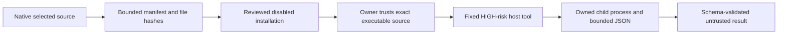

# Local plugin manager and SDK v1

The manager installs only an explicitly native-selected local source folder. Packages are inspected, fingerprinted and installed **disabled** under the user's runtime `plugins` directory, outside source. No marketplace, download, dependency installer, automatic update or automatic execution exists.

Manifest fields: `sdk_version`, stable reverse-domain-style `id`, semantic `version`, `name`, `description`, `compatibility` (`clydex-v2-sdk1`), relative `.py` `entry`, declared `permissions`, `dependencies`, typed `tools`, `events`. Current dependencies must be empty; only the fixed `plugins.execute` permission request is accepted. It is a declaration, not a grant. Unsupported contracts/versions, traversal, links/reparse paths and unknown fields fail. Package inspection bounds depth, time, entries, 64 files and 2 MiB; supported files are source/JSON/Markdown/text, never executable archives.

Install binds all file checksums. Enabling requires owner source review and an explicit **trusted OS-user code** attestation. Every invocation uses the fixed HIGH-risk host wrapper and its exact-action review. Source changes invalidate execution. Removing a plugin verifies its resolved runtime directory first. Installed version/checksums and observed last success/failure are the update/health metadata; no invented upstream update or health status is shown. Updates are separately inspected disabled installations.



Process isolation is **not an OS sandbox**. Reviewed code runs as the Windows user and could access OS resources available to that user. The SDK supplies no reusable credential, arbitrary host callback or permission service. Environment credentials are not forwarded to the plugin helper. Do not enable hostile/unreviewed code; hardened lower-privilege hostile-plugin containment remains an external security design/acceptance gate, not a delivered guarantee.

The owned child receives JSON on stdin:

```json
{"sdk_version":1,"operation":"tool","tool":"echo.text","arguments":{"text":"Synthetic fixture"},"configuration":{}}
```

It returns one JSON object:

```json
{"sdk_version":1,"result":{"text":"Synthetic fixture"},"logs":["complete"]}
```

The parent validates the declared result schema and allowlisted log codes, bounds output/time and Windows job memory/descendants, and discards arbitrary stderr diagnostics. Cancellation terminates the owned process tree; no subsequent workflow action runs. Completed effects cannot be undone. The fixed private helper supports source and windowed frozen runtimes without another Core. Arbitrary native Python extensions/dependency loading are not promised by this stdlib-only initial runtime.

[Synthetic Echo](../examples/plugins/synthetic_echo/plugin.json) is original offline example code; it needs no account, private data or network. [sdk.py](../src/clydex/plugins/sdk.py) supplies typed tool/context/cancellation, workflow-wrapper, feed, integration, event and health interfaces plus sanitized logs/configuration contracts. Tool registration, typed invocation and workflow wrappers are implemented. Feed/event/integration/health adapter protocols are **SDK contracts**, not automatically loaded runtime extensions; no untrusted manifest can subscribe itself or install new ToolSpecs. Dynamic extension adapters and richer per-plugin configuration remain partial. The current child receives an empty configuration object.
